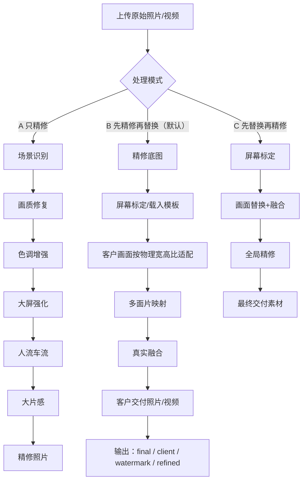
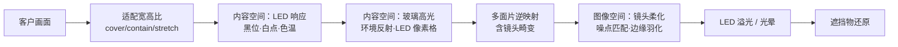
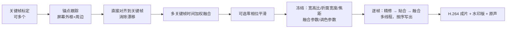

# 06 · 上刊照片精修与大屏素材合成系统（Studio）

> 独立模块，代码在 [`studio/`](../studio)。Python + OpenCV 处理引擎 + 浏览器工作台，后续可通过 HTTP 接口对接 CRM 工单。
> 核心原则：**只改“质感”不改“内容”**——精修全部是确定性的像素 / 局部滤波处理，不使用生成式重绘，建筑、道路、屏幕位置不会被改动；客户画面替换按真实几何映射，而不是“贴图拉伸”。

---

## 1. 系统功能说明

| 层 | 功能 | 实现位置 |
|---|---|---|
| 基础：精修增强 | 坏点修复、去噪/去压缩伪影、动态范围优化、细节恢复、去雾通透、场景识别（白天/黄昏/夜景）、电影感调色、天空局部优化、高光回收、大屏强化（提亮/饱和/文字清晰度/LED 溢光）、大片感（光晕/空气透视/暗角/颗粒）、自适应锐化、高光保护 | `enhance.py` `analysis.py` |
| 基础：人流车流 | 车流光轨（夜景/黄昏，程序生成，透视正确）、人物/车辆素材贴入（透视比例尺、阴影、光影匹配、遮挡排序） | `crowd.py` |
| 进阶：画面替换 | 平面屏、弧形屏、L 型拐角屏、多折面 / 异形折屏；静态图片与视频；按物理宽高比适配客户画面 | `geometry.py` `replace.py` |
| 进阶：真实融合 | 亮度/黑位/白点匹配、色温匹配、对比度（LED 实拍响应）、玻璃高光与环境反射、LED 溢光光晕、噪点匹配、镜头柔化、镜头畸变、边缘羽化、遮挡物保留、LED 像素格（可选） | `replace.py` |
| 进阶：视频 | 屏幕锚点跟踪（不漂移/不抖动）、多关键帧修正、逐帧合成、客户视频按时间同步播放、H.264 输出、保留原声 | `video.py` |
| 交付 | 精修原图、客户替换照片/视频、客户交付版（指定分辨率）、带醒目水印版、历史版本、点位模板复用 | `pipeline.py` `server.py` |

### 启动

```bash
cd studio
python3 -m venv .venv && .venv/bin/pip install -r requirements.txt   # 首次
.venv/bin/python run.py                                               # 打开 http://localhost:8600
.venv/bin/python -m pytest                                            # 运行测试
.venv/bin/python scripts/make_demo.py                                 # 生成演示素材到 data/demo
```

环境变量：`STUDIO_PORT`（默认 8600）、`STUDIO_HOST`（默认 127.0.0.1，局域网共享用 0.0.0.0）、`STUDIO_DATA_DIR`、`STUDIO_WORKERS`。
无需单独安装 ffmpeg（`imageio-ffmpeg` 自带）。

---

## 2. 处理流程图



替换子流程（图片与视频逐帧共用）：



视频子流程：



---

## 3. 输入输出示例

**输入**

| 类型 | 格式 | 说明 |
|---|---|---|
| 原始素材 | JPG / PNG / TIFF / WEBP；MP4 / MOV | 真实上刊照片、航拍照片、实拍 / 航拍视频，最大 4GB |
| 客户素材 | 同上 | 客户广告图或广告视频；视频按原片时间同步播放，短于原片时循环 |
| 点位模板 | JSON | 一次标定、重复使用；换分辨率自动换算 |

点位模板示例（L 型拐角屏，两面物理宽度 12m + 8m，高 6m）：

```json
{
  "name": "万达广场 L 型屏 - 东北角航拍",
  "type": "folded",
  "top":    [[812, 402], [1406, 455], [1730, 391]],
  "bottom": [[826, 731], [1398, 812], [1712, 702]],
  "image_size": [3840, 2160],
  "u_mode": "physical",
  "segment_widths": [12, 8],
  "physical_size": [20, 6],
  "occluders": [[[1100, 500], [1112, 500], [1112, 900], [1100, 900]]]
}
```

**输出**（每个任务一个目录 `studio/data/jobs/<任务号>/out/`）

| 文件 | 内容 |
|---|---|
| `refined.jpg` | 精修增强照片（流程 B，替换前的底图） |
| `final.jpg` / `final.mp4` | 最终成片（原分辨率） |
| `client.jpg` | 客户交付版（按“输出分辨率”导出，无水印；视频即 final.mp4） |
| `watermark.jpg` / `watermark.mp4` | 带醒目水印版（斜向平铺 + 右下角大字） |
| `poster.jpg` | 视频关键帧截图 |
| `track.json` | 视频每帧屏幕点位与跟踪质量 |
| `job.json` | 参数、处理报告（场景识别结果、各步骤、融合测量值、跟踪误差、耗时） |

**HTTP 接口**（对接 CRM 时使用）

| 方法 | 路径 | 说明 |
|---|---|---|
| POST | `/api/uploads` | 上传素材（multipart `file`），返回 id、尺寸、帧率 |
| GET | `/api/uploads/{id}/preview?frame=N` | 预览图 / 视频第 N 帧 |
| POST | `/api/uploads/{id}/detect` | 自动框选屏幕候选 + 场景识别 |
| GET/POST/DELETE | `/api/templates` | 点位模板 |
| POST | `/api/geometry/preview` | 标定实时预览：屏幕宽高比、焦距、面片分界线 |
| POST | `/api/jobs` | 创建任务：`{base_id, ad_id, mode, template \| keyframes, enhance, fusion, crowd, lanes, video, output, preview, title, parent_id}` |
| GET | `/api/jobs`、`/api/jobs/{id}` | 任务列表 / 进度与结果 |
| DELETE | `/api/jobs/{id}` | 删除版本 |

---

## 4. 屏幕标定方法

三种屏幕用同一种数据结构：**上边缘点列 + 下边缘点列，一一对应**。同一列的上、下两点应落在屏幕同一条竖直线（LED 箱体竖缝 / 折角线）上。

| 屏幕 | 怎么标 | 建议 |
|---|---|---|
| 平面屏 | 依次点 左上 → 右上 → 左下 → 右下 | “自动识别”可给出四角初值，再放大微调 |
| 弧形屏 | 上边缘从左到右点 7–11 个点 → 回车 → 下边缘同样数量 | 点尽量落在箱体竖缝上，并选“控制点等间距”；点越多越准（见 §8 实测） |
| 拐角 / 折角屏 | 上边缘：左端 → 每个折角 → 右端 → 回车 → 下边缘同样 | 有图纸就在“每段宽度”填各面物理宽度（米） |
| 遮挡物 | “遮挡物”工具圈出屏前的路灯杆、树、招牌 | 替换后这些区域保留原图 |
| 车道 / 人行道 | 沿一侧边线点 → 回车 → 另一侧边线 → 回车 | 在列表里填物理宽度（双向四车道约 14m） |
| 视频 | 在任意帧标定；镜头复杂时拖动帧滑块到问题帧“加关键帧”修正 | 各关键帧点数和类型须一致 |

操作：滚轮缩放、右键或空格拖动平移、拖动点位微调、回车/双击进入下一步、⌘Z / 退格撤销、“加一列点”在最宽的一段中间插入一列。

**标定辅助工具（真实样片测试后加入，强烈建议每次都用）**

| 按钮 / 字段 | 作用 | 什么时候必须用 |
|---|---|---|
| 整屏转角(°) | 最左一段与最右一段的水平夹角。L 型拐角屏 = 90（选“拐角屏”时默认填好）；圆角 L 型弧形屏也填 90 | **拐角屏一律填**。不填时焦距只能靠单个面的透视估计，几乎侧着看的那一面会被算宽到 1.5 倍（真实样片实测） |
| 吸附边缘 | 直线边沿全长取 13 个点吸附到真实边缘、直线拟合，角点取相邻边线交点；弧形屏中间点逐点吸附 | 点完后点一次。手点误差 ~3–5px，吸附后 ~1px；会报告每个点移动了多少，不对可撤销 |
| 展开检查 | 把照片里的屏幕按物理比例展开成平面图 | 保存模板前看一眼：原屏画面里的**汉字应接近正方形、圆应是正圆、二维码应是正方形**。某一面的字被压扁 / 拉宽 = 点位或转角有误 |
| 估计畸变 | 用“物理上是直线”的屏幕边估计镜头桶形 / 枕形畸变 k1 | 广角航拍、屏幕在画面边缘时；直线度没有明显改善时保持 0 |
| 边缘外扩（参数） | 屏幕外轮廓外扩 1px（按 3000px 长边计） | 默认开启，防止标定差一两个像素时原广告从边缘漏出一条 |
标定完成后侧栏实时显示**屏幕宽高比、焦距估计、各段宽度比、客户素材比例是否一致**——这是检查标定是否合理的最快办法（例如已知屏幕 20m×6m，宽高比应接近 3.33）。

保存为模板后，同一点位同一机位的后续素材直接“载入模板”，分辨率不同会自动换算。

---

## 5. 图片精修方案

| 步骤 | 方法 | 防失真措施 |
|---|---|---|
| 坏点修复 | 比 8 邻域极值还亮/暗超过阈值的孤立像素 → 中值替换 | 只看极值不看中值，真实灯点、窗格角点不会被误修（测试覆盖） |
| 去噪 / 去压缩伪影 | Immerkær 噪声估计 → 亮度 NLM（强度随噪声自适应）+ 色度导向滤波 | 回加 18% 原始细节，避免“油画感” |
| 动态范围 | 对数亮度导向滤波分解 base/detail：压缩大尺度明暗、按场景曝光、细节增强只作用于纹理区 | 天空等平滑区不加细节（防噪点 / 色带）；高光软压缩 |
| 通透感 | 暗通道先验去雾（白天 / 黄昏，轻度） | 透射率下限 0.55 |
| 场景调色 | 夜景 / 黄昏 / 白天预设 × 自然 / 电影感 / 夜景增强 / 商圈大片；S 曲线、分离色调、自然饱和度（肤色保护）、色温偏移 | 夜景抬黑位不死黑；自然饱和度对已饱和区域少加 |
| 局部优化 | 天空（白天偏振感、黄昏渐变层次、防色带平滑）；高光回收（玻璃反光、灯箱） | 天空掩码与画面上边缘连通才生效 |
| 大屏强化 | 屏幕掩码内提亮 + 软压缩、饱和、小半径局部对比（文字清晰）、LED 向外溢光 | 只在屏幕邻域计算；需要标定屏幕 |
| 大片感 | 多尺度光晕（滤色叠加）、空气透视、暗角、胶片颗粒 | 强度按场景自动降档，白天几乎不加光晕 |
| 输出锐化 | 亮度 USM，半径随分辨率；软阈值不放大噪声；局部极值钳制防白边 | — |
| 高光保护 | 全部步骤后统一软压缩 | 避免屏幕 / 灯光死白（测试：过曝像素 < 2%） |

---

## 6. 视频合成方案

| 要求 | 做法 |
|---|---|
| 逐帧处理 | 每帧独立：精修（视频模式）→ 几何 → 贴合 → 融合；帧间无依赖，多线程并行、按序写出 |
| 跟随镜头推拉摇移 | 屏幕外框 + 周边一圈做特征跟踪（屏幕内部内容在变，不用来跟踪）；每帧估计关键帧→当前帧单应矩阵 |
| 不漂移 | 跟踪点保持“关键帧身份”，单应始终直接从关键帧估计（不逐帧连乘）；每帧再反变换回关键帧做一次直接对齐修正残差 |
| 不抖动 | 前后向光流一致性检查（>0.8px 丢弃）、RANSAC 去外点、补点时反推关键帧坐标 |
| 不延迟 | 离线处理，平滑（如开启）为零相位、点对称延拓，线性运动完全不变（测试覆盖） |
| 不闪烁 | 融合参数（白点、黑位、色温、噪声）、调色参数、屏幕宽高比 / 折面宽度 / 焦距都在关键帧测一次后冻结 |
| 客户视频播放速度正常 | 按原片时间戳 t 取客户视频第 ⌊t·fps⌋ 帧，帧率不同也同步；短于原片则循环（可关） |
| 长镜头 / 大角度变化 | 多关键帧：相邻关键帧之间双向跟踪，按时间距离线性加权融合 |
| 输出 | H.264（libx264, yuv420p, CRF 可调），保留原片音轨，同时输出水印版 |

**轨迹平滑默认关闭**：实测跟踪噪声 < 0.05px，而平滑会抹掉真实的镜头抖动，使屏幕相对建筑“漂浮”（合成测试中开启平滑反而带来 0.5px 误差）。仅在跟踪质量差（夜景暗、运动模糊重）时开 0.5–1。

---

## 7. 弧形屏与拐角屏技术方案

### 7.1 统一表达：一串共享边的平面面片

所有屏幕都被拆成若干个**平面四边形面片**，每个面片有自己的单应矩阵（透视变换），相邻面片共享同一条边：

- 平面屏：1 个面片
- 拐角 / 折角屏：每个折面 1 个面片（**多面片投影**）
- 弧形屏：沿弧线加密为几十到上百条细面片（**曲面 UV 映射 / 网格形变**）

渲染时对每个输出像素求逆映射（输出像素 → 客户画面坐标），用 `cv2.remap` 一次采样；客户画面远大于屏幕像素时先面积下采样，防摩尔纹。

### 7.2 关键：客户画面按“物理宽度”分配，而不是按图中像素长度

“禁止整体硬拉伸”的本质是：客户画面在屏幕上横向的分布必须和屏幕**物理**宽度成正比。图中像素长度受透视（近大远小）和朝向（斜看压缩）影响，直接按像素分配就会出现一侧文字被压扁、另一侧被拉宽。系统提供三种分配方式：

| 方式 | 原理 | 适用 |
|---|---|---|
| 自动（auto） | **单视图矩形宽高比估计**（Zhang & He 2007）：每个折面在物理上是矩形，由它在图中的透视形状 + 焦距反推真实宽高比。焦距优先级：已知焦距 > **整屏转角约束**（两端面水平消失点 v₁、v₂ 的反投影方向夹角 = 转角，解出 f）> 各面联合估计（按透视强度加权中位数） | 拐角屏（填转角）、平面屏，不需要任何尺寸资料 |
| 等间距（equal） | 控制点之间物理宽度相等 | 弧形屏按箱体竖缝标点时最准 |
| 物理宽度（physical） | 用户填写每段宽度（米） | 有图纸 / 点位资料时 |

### 7.3 弧形屏：母线三维重建

弧形屏由竖直、等高的母线（LED 箱体竖缝）组成，这一约束足以在单张照片里重建它的三维形状：

1. 上、下边缘控制点用**中心向心 Catmull-Rom 样条**拟合（穿过每个控制点、不打结），按段加密采样；
2. 最左、最右两条母线的四个端点构成物理矩形 → 单应分解得到屏幕竖直方向与尺度；
3. 每条母线：上端点在射线 r_T 上、下端点在射线 r_B 上，且“下端 − 上端 = 竖直方向 × 屏高” → 最小二乘求深度，得到每条母线的三维位置；
4. 沿上边缘累计**三维弧长**作为客户画面横向坐标 u。
5. 上弧线上每个采样点的“下端对应点”取指向**竖直消失点**的直线与下弧线的交点（即真实母线），而不是按样条参数机械对应；否则控制点间距不均时相邻细面片竖向透视不一致，斜线和文字会出现台阶（真实样片中发现）。

这样画面中心与两侧的密度自动符合曲率和镜头透视，文字不会在两侧被压扁。面片内的竖直方向透视（仰拍时上窄下宽）由每个面片的单应矩阵精确处理。若重建退化（极端角度），自动回退到“弦面单应投影”分配。

### 7.4 拐角屏：多面片投影 + 折缝融合

1. 每个折面单独一个单应矩阵，面内透视精确；
2. 折缝两侧面片共享同一条边（同一对上下点），客户画面在折缝处 u 坐标连续 → 文字、LOGO 自然弯折过去，不会错位；
3. 折缝两侧 ±2px 内对**映射坐标**（不是颜色）按到折缝距离线性加权，消除两侧单应在折缝上的微小不一致，不产生重影；
4. 覆盖率用各面片的抗锯齿覆盖相加（共享边两侧恰好互补为 1），折缝处不会出现缝隙或撕裂（测试：屏幕内部 alpha 全为 1）。

### 7.5 去“贴纸感”的融合细节

| 项 | 做法 |
|---|---|
| 亮度 / 对比度 | 把客户画面当作 LED 发光：输出 = 黑位 + (白点 − 黑位) × 画面。白点取原屏最亮像素（受本照片曝光影响），黑位取“原屏最暗值”与“周边立面亮度”的较小者（屏面反射的环境光） |
| 色温 | 原屏高光接近中性 → 用它的颜色作 LED 白点；否则按周边环境光（shades-of-gray）弱化匹配 |
| 发光 / 光晕 | 屏幕发光层两尺度模糊后滤色叠加到屏幕外；夜景最强、白天最弱 |
| 玻璃反光 / 环境反射 | 在**内容空间**生成斜向高光带 + 屏幕上方环境的翻转模糊影像，低强度滤色叠加，随曲面 / 折面一起形变 |
| 噪点 | 测周边环带噪声水平，按亮度相关的散粒噪声形态加回 |
| 清晰度 | 镜头柔化（随分辨率），贴入画面不比原片更锐 |
| 镜头畸变 | 径向 k1/k2 模型，几何在无畸变坐标计算，输出像素经畸变模型反查；k1 可由屏幕直边自动估计 |
| 各面明暗 | 在未精修原片上测每个面 / 段的白电平（98 分位），按比例还原 LED 视角衰减；弧形屏段间平滑、折角屏折缝处突变 |
| 边缘 | 抗锯齿覆盖率 + 可调羽化 |
| 遮挡 | 遮挡物多边形内保留原图（发光层也在遮挡物之后） |

---

## 8. 测试用例与实测结果

自动化测试：`cd studio && .venv/bin/python -m pytest`（39 项，约 20 秒）。
几何测试使用**已知三维场景的精确渲染作为真值**（平面：精确单应；拐角屏：两个平面 6m+4m；弧形屏：光线-圆柱求交），度量贴合误差（像素）。

| 用例 | 场景 | 结果 |
|---|---|---|
| 平面屏 | 1280×720，斜视 | 映射误差 p99 < 0.2px；宽高比与焦距从照片恢复（误差 < 0.5% / 1%） |
| 拐角屏 · 自动 | 6m+4m L 型，不给任何尺寸 | 两面宽度比 1.500、整体 3.333 均与真值一致（<1%）；误差 p99 < 0.3px；折缝无缝隙 |
| 拐角屏 · 物理宽度 | 填写 6,4 | 误差 p99 < 0.3px |
| 拐角屏 · 反例 | 两面等宽硬分 | 平均误差 > 10px（证明按物理宽度分配是必要的） |
| 弧形屏 | 100° 圆柱弧，7 / 9 个控制点 | 平均误差 0.40 / 0.19px（p95 2.1 / 1.2px）；宽高比误差 < 1% |
| 弧形屏 · 反例 | 当作平面四点处理 | 误差为曲面映射的 5 倍以上 |
| 噪声估计 | σ = 1.3–10 (0–255) | 误差 < 8% |
| 坏点修复 | 含大量小灯点的夜景 | 0 误修；人工坏点被修复 |
| 精修结构保持 | 夜景 + 屏幕 | 80% 以上边缘位置不变；过曝像素 < 2% |
| 视频确定性 | 同一帧处理两次 | 结果逐像素相同（无随机闪烁） |
| 融合 | 夜景 L 型屏 | 屏内噪声与原图同量级；黑位 0.01–0.2；屏幕外侧光晕 |
| 遮挡物 | 屏前竖杆 | 杆区域与原图逐像素一致 |
| 车流光轨 | 夜景双向车道 | 光轨不出车道（仅光晕外溢）；不覆盖大屏 |
| 素材贴入 | 透视人行道 | 人物高度随落脚点远近单调变化，近处高度符合 1.7m × 比例尺 |
| 视频跟踪 | 60 帧平移 + 推近 25% + 旋转 + 2px 手抖 | 关键帧在首 / 中 / 首尾三种设置下平均误差 < 0.15px、最大 < 0.6px，末尾无漂移；帧间抖动 < 0.1px |
| 平滑零延迟 | 线性运动 | 平滑后完全不变 |
| 视频合成 | 20 帧 | 帧数、尺寸正确；水印版存在；跟踪重投影误差 < 1px |
| 客户视频时间同步 | 25fps | 按时间取帧、回绕正确 |
| HTTP 端到端 | 上传 → 模板 → 任务 → 下载 → 删除 | 全通过；缺客户素材时返回 400 |

性能（Apple Silicon，实测）：1920×1080 图片流程 B 约 3 秒；3000×2000 精修约 4 秒；1080p 视频约 0.56 秒/帧（含跟踪、两路 H.264 编码）。快速预览把图片缩到 1400px，视频只处理关键帧。

### 真实样片测试（2026-11-12，官网飞书素材）

用官网项目里的真实上刊原片（6144×4096 / 4963×3171，EXIF 已被飞书去除），客户画面用从其他照片里展开出来的真实广告（东风奕派 M8、中国移动）充当，结果存放在 `studio/data/real-tests/`（每例含 对比图、展开检查、final / client / watermark；本地文件，不入库），点位模板已存入“点位模板”页。点位归属以官网 `photo-review.json` 的 `verified_screen` 为准；本地测试文件夹 / 模板中的“光谷L型屏”“郎酒平面屏”是测试时的误命名，实为三镇之眼、徐东欧亚达。

| 样片 | 屏幕 | 场景识别 | 结果 |
|---|---|---|---|
| 马客茂（record-007-09） | 圆角 L 型弧形屏，左面几乎侧对镜头 | 黄昏 ✓ | 画面绕过圆角连续，左面文字透视压缩与原片一致；左面亮度比正面暗约 7%（与原片实测一致） |
| 徐东欧亚达（record-026-01，画面为青花郎广告） | 平面屏，阴天白天 | 白天 ✓ | 圆保持正圆、文字清晰；天空保持明亮 |
| 三镇之眼（record-142-01） | 直角 L 型拐角屏，夜景航拍 | 夜景 ✓ | 画面跨折缝自然弯折；车道上加车流光轨（13 条） |

**测试中发现并已修复的问题**（均已加回归测试）：

1. **拐角屏宽度算错 1.5 倍**：几乎侧对镜头的一面，单矩形焦距估计不稳定（估出 10695px，实际约 5100px），该面画面被拉宽。→ 新增“整屏转角”：两端面夹角已知时由消失点直接求焦距；展开检查确认汉字恢复方正。
2. **弧形屏斜线 / 文字在控制点处错位**：上下弧线按样条参数机械对应，控制点间距不均时相邻细面片竖向透视不一致。→ 改为沿“竖直消失点”方向对应上下点（真实母线），控制列保持用户标定。
3. **原广告从屏幕边缘漏出一条**：屏幕右边缘因相机未水平而倾斜 13px，手工估计没跟上。→ 新增“吸附边缘”（多点直线拟合 + 交点）与默认边缘外扩。
4. **阴天白天精修后发灰发暗**：去雾作用到了天空、曝光被往下拉、大尺度压缩压暗亮部、灰天被当蓝天做“偏振压暗”。→ 天空不去雾；白天 / 黄昏不降曝光；压缩只提暗部；灰天只增强云层层次。
5. **饱和色块单通道溢出**：→ 输出前做色域压缩（保持色相与亮度）。
6. **车流光轨过密过亮糊成一片**：→ 每车道约 3 条、亮芯 7cm、光晕减弱。
7. **贴图各面亮度一致显得像“弯折的贴纸”**：→ 在原片上测各面白电平（LED 视角衰减），按比例还原到新画面（“各面明暗匹配”参数）。

**仍需注意**：
- 吸附边缘在“画面内容有紧贴屏幕边的平行线条”时偶尔会吸错（合成困难样例中约 1/7 的点变差），所以会显示每个点的移动量，务必放大检查。
- 各面明暗只能在原片各面都有未过曝的白色时测出；原画面已大面积过曝时保持一致亮度。
- 精修对已经修过的原片改动很克制（这是刻意的）；需要更强效果时调高“精修强度 / 大片感”。
- 样片较少（3 组），尚未覆盖：街拍近景大量人群遮挡（如 record-054-01）、真实航拍视频、白天强逆光。

### 后续真实案例验收建议

建议每类各取 2–3 组：

1. 白天平面屏实拍（检查通透感、天空、屏幕不发白）
2. 夜景弧形屏航拍 + 16:9 客户 KV（检查曲面文字比例、溢光、黑位）
3. 黄昏 L 型拐角屏 + 竖版 / 横版两种客户素材（检查折角处文字连续）
4. 航拍推近视频 + 客户 15 秒 TVC（检查不漂移、不闪烁、播放速度）
5. 有路灯杆遮挡的点位（检查遮挡物保留）

每组保存点位模板，验收通过后作为该点位的标准模板。

---

## 9. 能力边界与扩展

| 项 | 现状 | 扩展建议 |
|---|---|---|
| 行人 / 车辆增加 | 夜景光轨为程序生成，效果可靠；白天依赖素材库 `studio/assets/sprites/{people,vehicles}/*.png`（**当前为空**，需自行放入透明底 PNG：同一机位角度拍摄的人物 / 车辆抠图效果最好） | 接入生成式局部重绘（inpainting）服务作为可选后端，按车道 / 人行道掩码生成；仍需人工审核 |
| 超分辨率 | 输出放大为 Lanczos + 轻锐化，不“生成”细节 | 可接入 Real-ESRGAN 等超分模型（需 GPU） |
| 视频人流车流 | 视频任务不做（静态光轨在视频中不成立） | 需生成式视频模型 |
| 屏幕前方大面积遮挡 | 需手工圈遮挡物；视频中遮挡物按屏幕同一单应移动，适合与屏幕同平面的遮挡（招牌、框架）；独立移动的遮挡（行人、车辆）暂不处理 | 接入人像 / 物体分割模型自动生成逐帧遮挡掩码 |
| 强视差航拍 | 跟踪用屏幕周边区域的单应近似；屏幕与周边不共面且视差大时，长镜头建议多加关键帧 | 结构光 / SfM 三维跟踪 |
| 异形屏 | 只要能用“上边缘点列 + 下边缘点列”描述（含弯折 + 弧形混合）都支持；顶 / 底不成对应关系的异形（如圆形屏）不支持 | 自由网格标定 |

## 10. 与 CRM 对接

Studio 是独立服务，CRM 侧建议：

1. 在点位 / 订单上存 Studio 的**模板 id**（`/api/templates`）；
2. 上刊后上传实拍素材与客户 KV，调用 `POST /api/jobs` 创建任务，`title` 填订单号；
3. 轮询 `GET /api/jobs/{id}`，完成后把 `outputs.client` / `outputs.watermark` 链接写回工单（未结款发水印版，结款后发客户版）。

Studio 当前没有登录鉴权（默认只监听本机）。如需局域网共享，请放在 CRM 同一反向代理后，由 CRM 统一鉴权。
